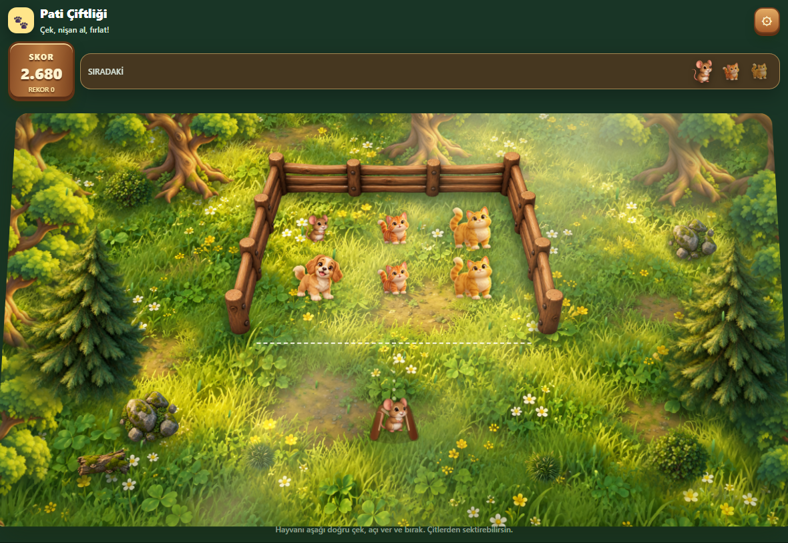
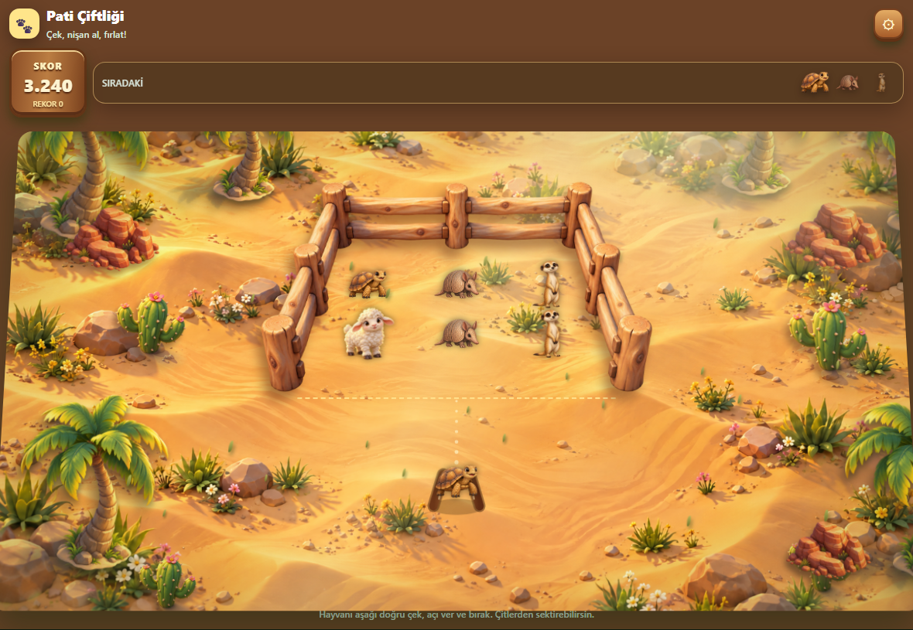
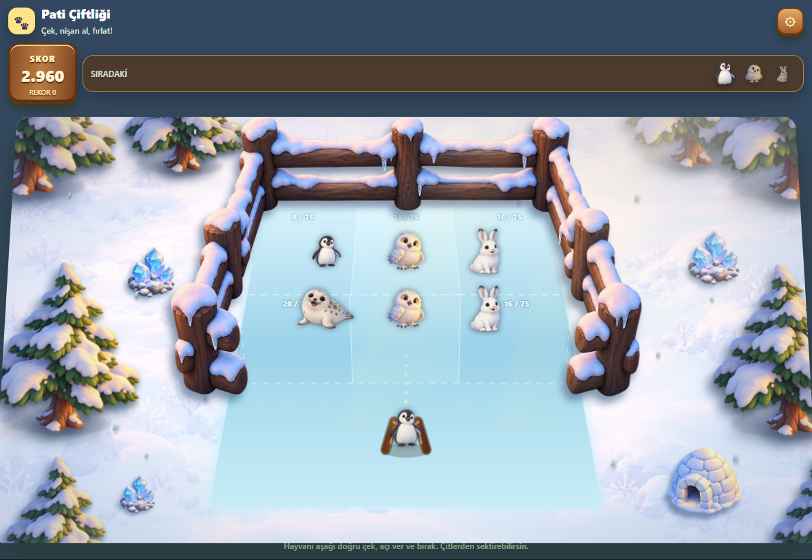

<h1>Pati Çiftliği 🐾 </h1>

Pati Çiftliği, hayvanları sapanla oyun alanına fırlatıp aynı türleri birleştirerek geliştirdiğiniz yatay ekranlı, rahatlatıcı bir mobil birleştirme oyunudur.

## Haritalar

| Orman | Çöl | Kutup |
|---|---|---|
|  |  |  |

- 🌲 **Orman:** Klasik birleştirme deneyimi.
- 🌵 **Çöl:** Kum üzerinde farklı hareket hissi.
- ❄️ **Kutup:** Buz bölgelerini dengede tut; 50 ağırlıkta buz çatlar, 75'in üzerinde kırılır.
- 📱 Capacitor ile hazırlanmış Android uygulaması ve tarayıcı sürümü.

## Oyna ve indir

- [Tarayıcıda oyna](https://emrebalcan.github.io/pati-ciftligi/)
- [Android APK'yı indir](https://github.com/EmreBalcan/pati-ciftligi/releases/latest/download/PatiCiftligi.apk)

## Çalıştırma

```bash
npm install
npx cap sync android
```

Web sürümü `dist/` klasöründedir. Android projesi `android/` klasöründe yer alır.
